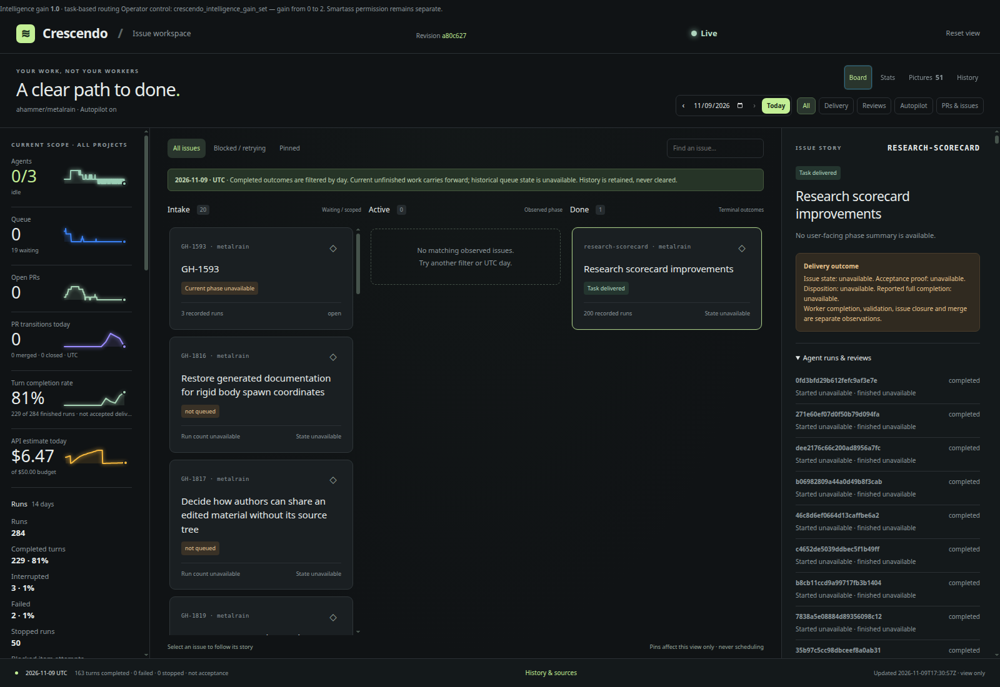

# Crescendo

Crescendo runs coding agents across your repositories from one local service. Give it ready
issues; it creates isolated workspaces and delivers pull requests. Projects share worker slots,
usage budgets and Codex quota, while a read-only web dashboard shows work, history and usage.



*Real instance, November 2026. The dashboard observes work; operator controls stay in local MCP.*

- **Several projects, one service.** Weighted scheduling, project caps and shared capacity.
- **Choose your level of autonomy.** New projects start with ready issues and operator PR review.
  Enable autonomous research and PR review/merge when your repository is prepared for it.
- **Match intelligence to work.** Inherit your Codex defaults, configure label routes, or opt into
  task-based intelligence gain: Luna for routine work, a Terra baseline, Sol for complex reasoning,
  and Astra behind timed Smartass permission.
- **Control resource use.** Daily API-equivalent budgets, quota back-off and optional read-only helpers.
  Repository tooling can serialize expensive builds, GPU work and acceptance checks separately.
- **See the evidence.** Retained run history and delivery observations distinguish completed turns,
  merged PRs, accepted deliveries and estimated usage. Research with no new publication is shown separately.

> [!WARNING]
> Crescendo is an engineering preview for trusted environments. Generated GitHub workflows run
> unattended with broad local permissions and can write to your repository. Review the workflow
> and prompts before starting the service.

## Quick start

You need Git, an authenticated Codex CLI on the service's PATH, an authenticated GitHub CLI (`gh`),
and access to a repository where you can create issues and pull requests. Source builds use
[mise](https://mise.jdx.dev/) to install Elixir/OTP. Start with a repository whose build and review
instructions are documented. No particular Codex model is required by the generated workflow;
helpers and intelligence gain have additional [model and platform requirements](docs/crescendo.md#intelligence-gain).

```bash
git clone https://github.com/ahammer/crescendo.git
cd crescendo/elixir
mise trust
mise install
mise exec -- mix setup
mise exec -- mix build
```

Follow the [first-service walkthrough](docs/crescendo.md#first-service) to generate your project,
create the service file, synchronize labels, and launch the dashboard at `http://127.0.0.1:4280`.
It starts with one primary slot and no autonomous intake or helper agents. Add `crescendo:ready`
to an issue to authorize work; review the resulting PR yourself.

Published platform executables are described in the [runtime guide](elixir/README.md#burrito-releases).
A single workflow can also run on its own:

```bash
./bin/crescendo path/to/WORKFLOW.md \
  --i-understand-that-this-will-be-running-without-the-usual-guardrails
```

## See it working

[Issue history and source evidence](.github/media/crescendo-issue.png) ·
[Usage, routing and run outcomes](.github/media/crescendo-usage.png)

These captures show a real Metalrain installation. They illustrate the interface, not a benchmark
or a promise of cost savings. API-equivalent USD estimates are separate from verified account costs.

## Documentation

- [Operator guide](docs/crescendo.md): first service, configuration, routing, budgets, automation and deployment.
- [Runtime reference](elixir/README.md): tracker adapters, workflow contract, platform builds and testing.
- [Contributing](CONTRIBUTING.md): local checks and review expectations.
- [Specification](SPEC.md): Symphony-derived orchestration contract with Crescendo extensions.
- [Delivery retrospectives](docs/retrospectives/): observed outcomes and rollout evidence.

GitHub Issues supports the full intake/review workflow. Linear, Jira Cloud, Asana and GitLab adapters
support issue execution; they do not imply GitHub autopilot feature parity. Advanced local helpers
use Linux-specific facilities; see the operator guide before enabling them or adaptive routing on
remote workers.

## About Symphony

Crescendo is derived from [Symphony](https://github.com/openai/symphony) by OpenAI. It extends the
reference implementation with multi-project scheduling, usage controls, routing, automation and
the web dashboard. The specification includes these extensions; it is not an unchanged upstream copy.

## License

[Apache License 2.0](LICENSE). See [NOTICE](NOTICE) for OpenAI and Crescendo attribution.
